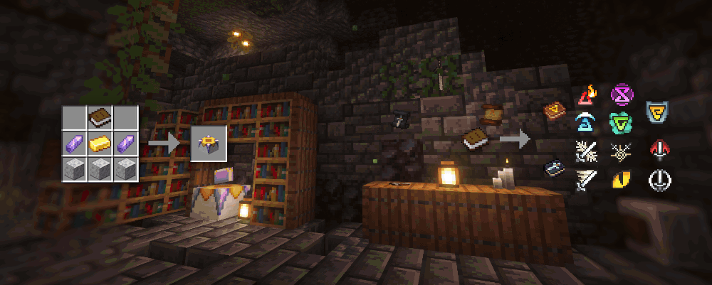
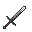

**How do you receive and cast the spells?**
* Spells from the spell book need the book equipped in the Trinket / Curios Mod's spell book slot.
* You need to have a weapon equipped, that can cast spells.
* To get a spell book, find or craft a Spell Binding Table.
* You can find a Spell Binding Table in villages with the [Gazebos](https://modrinth.com/mod/gazebos) Mod.
* Make sure to place 18 bookshelves around the Spell Binding Table.
*  Spell Scrolls with a single spell can be found in loot chests, they can be equipped or bound with lower XP- & Lapislazuli-cost on your spell book.
* Witcher Swords have the Witcher Reflexes skill bound on them.

**What does the Witcher do?:**
* Fighting monsters with silver and steel swords and casting the five Witcher signs.
* Signs damage, slow, charm or shield, fencing techniques deal heavy melee damage.
* Strengths: Versatile, melee damage combined with signs.
* Equipment: Witcher school armor sets for every play-style.

##  Witcher Sign Manual (Spell Book)

<!-- SPELLS:signs -->
| Icon | Sign | ID | Description |
|---|---|---|---|
|  | Aard | `witcher_rpg:aard` | Telekinetic thrust that damages enemies and knocks them back. |
|  | Igni | `witcher_rpg:igni` | Unleashes a stream of fire that damages and ignites enemies. |
|  | Yrden | `witcher_rpg:yrden` | Places a magic circle that slows enemies inside it. |
|  | Axii | `witcher_rpg:axii` | Charms the target, so it stops attacking and takes more damage. |
|  | Quen | `witcher_rpg:quen` | Creates a protective shield that absorbs damage. |
|  | Igni Firestream | `witcher_rpg:igni_firestream` | A concentrated stream of fire that damages and ignites enemies. |
|  | Aard Sweep | `witcher_rpg:aard_sweep` | A 360 degree telekinetic blast that damages and knocks back all nearby enemies. |
|  | Yrden Magic Trap | `witcher_rpg:yrden_magic_trap` | Places a magical trap that damages and slows enemies that enter it. |
|  | Axii Puppet | `witcher_rpg:axii_puppet` | Dominates the target and turns it into an ally with more attack damage. |
|  | Quen Active Shield | `witcher_rpg:quen_active_shield` | An active shield that absorbs damage and heals you. |
<!-- /SPELLS:signs -->

##  Witcher Techniques (Spell Book)

<!-- SPELLS:fencing -->
| Icon | Technique | ID | Description |
|---|---|---|---|
|  | Fast Attack | `witcher_rpg:fast_attack` | A series of fast attacks with a small forward dash. |
|  | Witcher Senses | `witcher_rpg:witcher_senses` | Reveals nearby enemies and exposes them: critical hits against them are stronger and more likely. |
|  | Strong Attack | `witcher_rpg:strong_attack` | Two heavy blows. |
|  | Battle Trance | `witcher_rpg:battle_trance` | Enter a battle trance that increases your attack damage. |
|  | Rend | `witcher_rpg:rend` | A charged overhead strike that deals heavy damage and disables shields. |
|  | Whirl | `witcher_rpg:whirl` | A spinning attack that damages all nearby enemies and blocks arrows. |
<!-- /SPELLS:fencing -->

##  Master Witcher Book (Spell Book)

The Master Witcher Book combines all signs of the Witcher Sign Manual and all techniques of the Witcher Techniques in one spell book.

##  Witcher Swords

<!-- SPELLS:swords -->
| Icon | Skill | ID | Found on | Description |
|---|---|---|---|---|
|  | Witcher Reflexes | `witcher_rpg:defensive_witcher_mechanics` | Witcher Swords | Sharpens your reflexes to block the next attack or arrow. |
<!-- /SPELLS:swords -->
