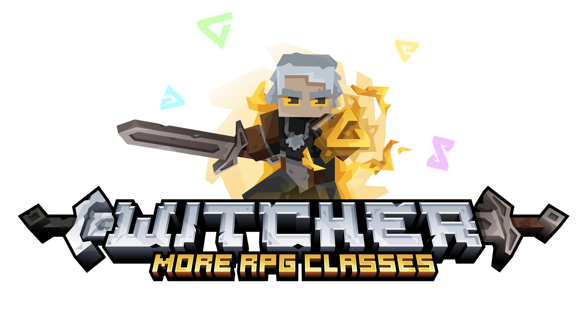
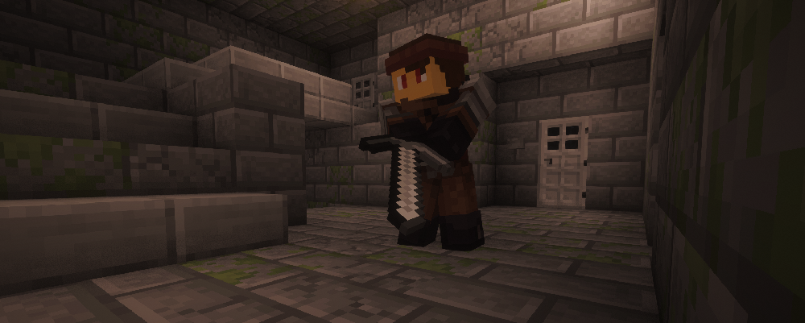
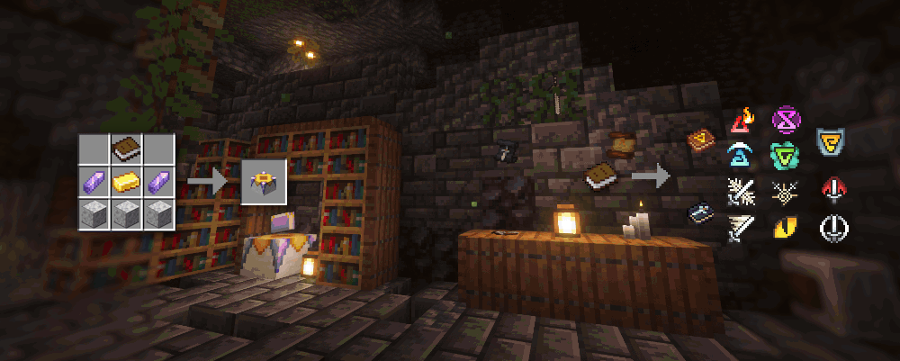
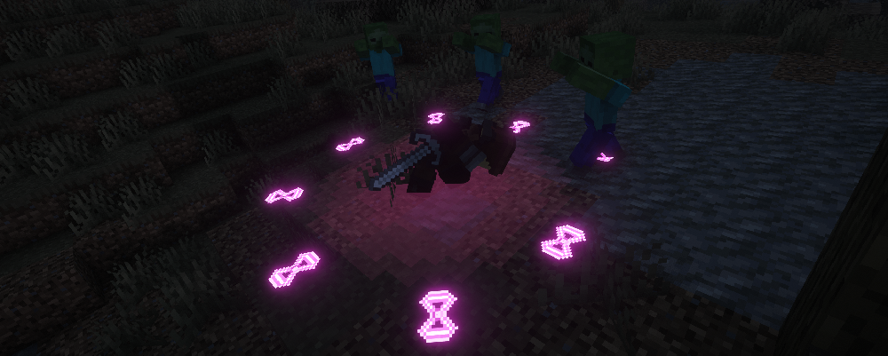
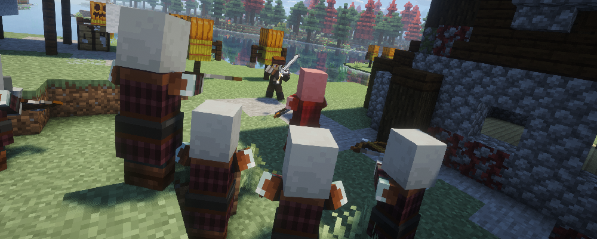
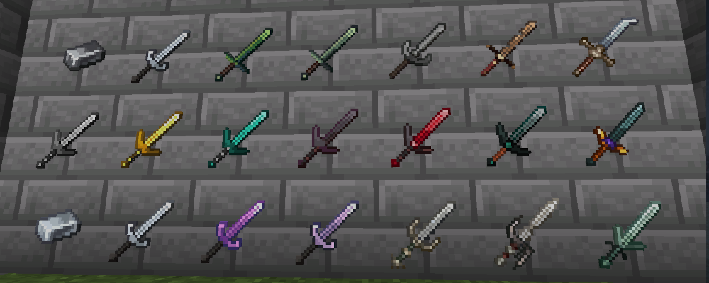
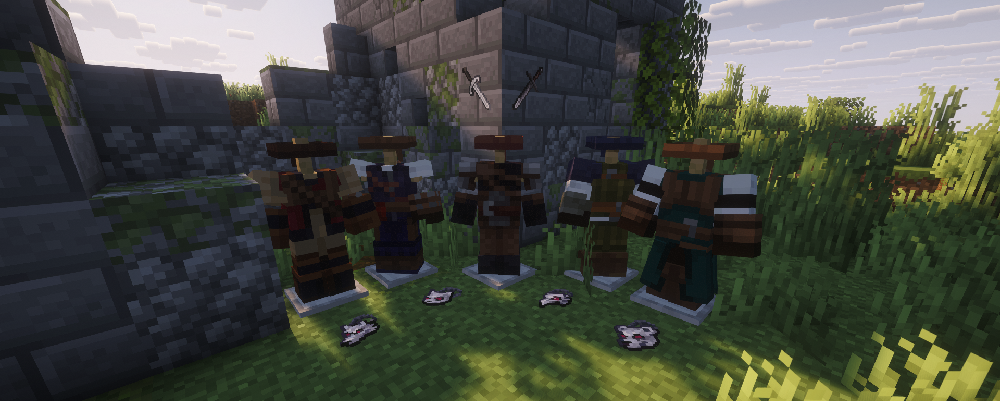
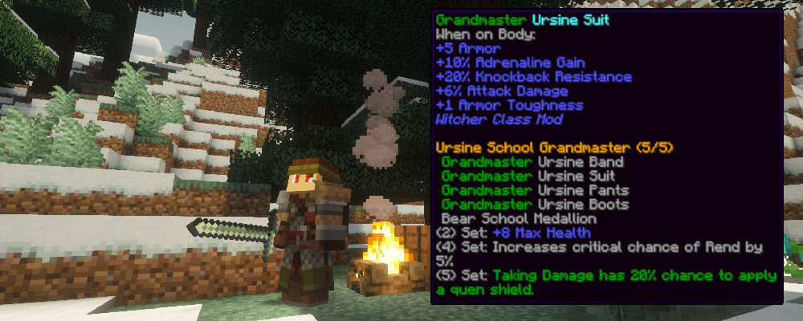
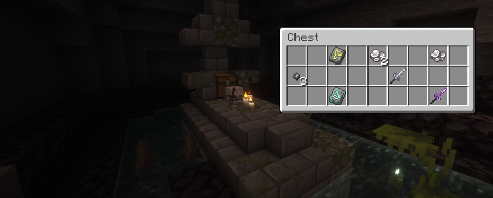

<h1>Slay monsters like a Witcher!</h1>
    

---

## 📂 Installation

### Required Mods

<table>
<thead><tr><th>Mod</th><th>Download</th></tr></thead>
<tbody>
<tr><td><b>Spell Engine</b></td><td> </td></tr>
<tr><td><b>More RPG Library</b></td><td> </td></tr>
<tr><td><b>Armor Model API</b></td><td> </td></tr>
</tbody></table>

### Highly Recommended / Compatibility Mods

<table><thead><tr><th>Mod</th><th>Compatibility Info</th><th>Download</th></tr></thead><tbody><tr><td><b>Better Combat</b></td><td>Built in weapon animations for all Witcher swords</td><td> </td></tr><tr><td><b>Jewelry</b></td><td>Needed for the Glyph &amp; Runestone system: socket Glyphs and Runestones into Witcher armor and swords</td><td> </td></tr><tr><td><b>The Conjunction of the Spheres</b></td><td>Adds Witcher gear to its loot chests. Its necrophages and ogroids count as silver-vulnerable, just like undead</td><td> </td></tr><tr><td><b>Additional RPG Jewelry</b></td><td>Adds Silver Sapphire and Steel Jade rings and necklaces, which need Witcher installed</td><td> </td></tr><tr><td><b>BetterNether</b></td><td>Adds the Ruby Witcher Sword</td><td> </td></tr><tr><td><b>BetterEnd</b></td><td>Adds the Aeternium Witcher Sword</td><td> </td></tr><tr><td><b>The Aether</b></td><td>Adds the Heavenly Witcher Sword</td><td> </td></tr><tr><td><b>Arsenal (RPG Series)</b></td><td>Adds the unique swords Winter's Blade, Ultimatum, Azure Wrath and Reach of the Damned</td><td> </td></tr><tr><td><b>MRPGC Skill Tree Add-On</b></td><td>Adds a full skill tree for the Witcher</td><td> </td></tr></tbody></table>

---

## 🕹️ Features

The Witcher class is inspired by the Witcher universe, mainly by The Witcher 3: Wild Hunt, and brings many of its battle mechanics to Minecraft.

### Spells

Make use of the new Witcher signs and fencing techniques to make fighting and combat more fun: equip a Spell Book and unlock all of its powerful spells!

To get one, find a Spell Binding Table in village <a href="https://modrinth.com/mod/gazebos">Gazebos</a>, or build your own (just don't forget the bookshelves around the Spell Binding Table).

To use a spell book, equip it and hold a weapon (vanilla or from third-party mods). All spells are listed in the <a href="https://github.com/ProfessorFichte/Witcher/wiki">Wiki</a>.

**Witcher Sign Manual**

Offers a huge range of magical signs that help you in different situations: Aard, Igni, Yrden, Quen and Axii, each with a stronger alternate form.

**Witcher Techniques**

Offers offensive fencing techniques, a battle trance and the Witcher Senses that reveal and expose your enemies.

Every Witcher sword also has the Witcher Reflexes skill to block the next attack or arrow.

**Master Witcher Book**

Craft the Master Witcher Book to combine the signs and the fencing techniques in one spell book.

### Combat & Equipment

- Craft and loot over 15 Witcher swords
- Silver swords are good for a sign build and strong against monsters weak to silver, steel swords are good for a physical build
- Some rare swords can't be crafted, you can only find them in loot chests

- Choose from over 20 armor sets and represent your favourite Witcher school
- Upgrade your school armor from the lowest rank to the grandmaster tier
- Craft a Witcher Medallion and pair it with your grandmaster armor for strong bonus effects

### Glyphs & Runestones

With <a href="https://modrinth.com/mod/jewelry">Jewelry</a> installed, craft Glyphs and Runestones from a base item and a themed material and socket them into your Witcher armor and swords. They can also be upgraded to a stronger tier.

### Structures & Loot

Find Witcher graves and lost ruins on your journey and loot useful Witcher gear from their chests.

### Ores & Metals

- Silver Ore from Y -64 to -22 (most common around Y -58), Dark Iron Ore from Y -64 to 16 (most common around Y -56) and in the Nether from Y 8 upwards
- Meteorite Ore from Y 36 to 256, most common around Y 146, high up in the mountains
- Steel is made by smelting Iron Ingots in a Blast Furnace
- Dark Steel and Meteorite Silver Ingots are crafted from the other metals and Netherite Scraps

### Attributes & Spell Schools

- New spell schools for every sign: Aard, Axii, Igni, Quen and Yrden
- Sign Intensity increases the damage of all signs, each sign also has its own intensity attribute
- Adrenaline Gain raises the chance to get the Adrenaline effect, which increases your attack damage and sign intensity
- Enchantments for signs

---

## ⚙️ Configuration

<table><thead><tr><th>Setting</th><th>File</th></tr></thead><tbody><tr><td>Armor &amp; weapon bonuses</td><td><code>config/witcher_rpg/equipment_v5.json</code></td></tr><tr><td>Equipment loot</td><td><code>config/witcher_rpg/loot_equipment_v1.json</code></td></tr><tr><td>Loot injections</td><td><code>config/witcher_rpg/loot_injection.json</code></td></tr><tr><td>Status effects</td><td><code>config/witcher_rpg/effects_v1.json</code></td></tr><tr><td>Trinkets</td><td><code>config/witcher_rpg/trinkets_v1.json</code></td></tr><tr><td>Elemental weaknesses</td><td><code>config/witcher_rpg/elemental_weaknesses.json</code></td></tr><tr><td>Features</td><td><code>config/witcher_rpg/features.json</code></td></tr><tr><td>Tweaks</td><td><code>config/witcher_rpg/tweaks.json</code></td></tr></tbody></table>

---

## 🎥 Showcases

<b>Witcher (RPG Series Plus) – Minecraft Mod Showcase</b>

<b>Witcher (RPG Series Plus) – Minecraft Mod Showcase</b>

<b>Witcher (RPG Series Plus) – Minecraft Mod Showcase</b>

Thanks to all content creators for showcasing my mod

---

## 🙌 Credits

<table><thead><tr><th>Who</th><th>Contribution</th></tr></thead><tbody><tr><td>Andrzej Sapkowski &amp; CD Projekt Red</td><td>Created the Witcher universe and brought it to life</td></tr><tr><td>Daedelus</td><td>Created the amazing Spell Engine API</td></tr><tr><td>CD Projekt Red</td><td>Sounds are modified versions of sounds from The Witcher 2 and The Witcher 3, all rights belong to CD Projekt Red</td></tr><tr><td>Damienbrittan</td><td>Created the awesome mod banner</td></tr><tr><td><a href="https://emil.art/">Emil</a></td><td>Created the spell textures</td></tr><tr><td><a href="https://bento.me/animun4ik">Animun4ik</a></td><td>Created all armor related assets</td></tr><tr><td><a href="https://sirghaith.artstation.com/">SirGaith</a></td><td>Created the spell book textures</td></tr><tr><td><a href="https://www.curseforge.com/members/tenebris_mors/projects">TenebrisMors</a></td><td>Created and shared the Witcher Better Combat animations</td></tr></tbody></table>

---

<h3>Check out my other RPG-themed mods!</h3>
<table>
<tbody>
<tr><td align="center" style="text-align:center"></td><td align="center" style="text-align:center"></td><td align="center" style="text-align:center"></td></tr>
<tr><td align="center" style="text-align:center"></td><td align="center" style="text-align:center"></td><td align="center" style="text-align:center"></td></tr>
<tr><td align="center" style="text-align:center"></td></tr>
</tbody>
</table>

<h3>Discover more of the RPG Series by Daedelus</h3>
<table>
<tbody>
<tr><td align="center" style="text-align:center"></td><td align="center" style="text-align:center"></td><td align="center" style="text-align:center"></td></tr>
<tr><td align="center" style="text-align:center"></td><td align="center" style="text-align:center"></td><td align="center" style="text-align:center"></td></tr>
<tr><td align="center" style="text-align:center"></td><td align="center" style="text-align:center"></td><td align="center" style="text-align:center"></td></tr>
</tbody>
</table>

<h3>More RPG content by other Spell Engine devs</h3>
<table>
<tbody>
<tr><td align="center" style="text-align:center"></td><td align="center" style="text-align:center"></td><td align="center" style="text-align:center"></td></tr>
</tbody>
</table>

---

Questions, bugs or ideas? Join the <a href="https://discord.com/invite/AShKd5XrTu">Discord</a> or open an issue on <a href="https://github.com/ProfessorFichte/Witcher/issues">GitHub</a>.

